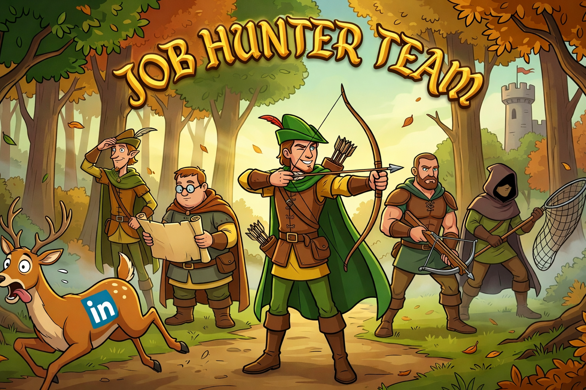
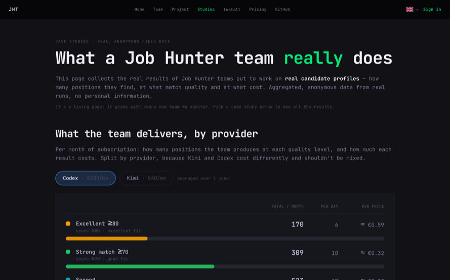
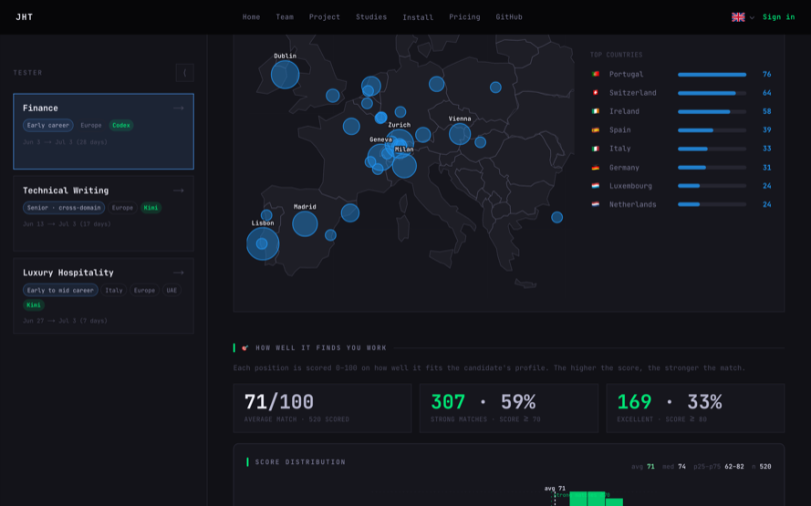
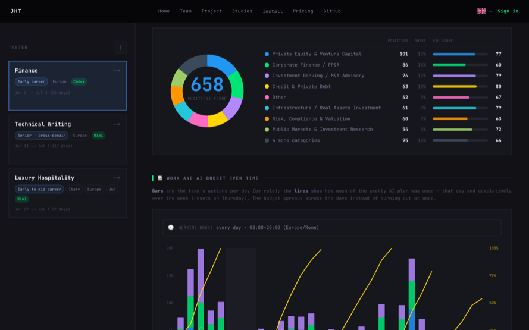

<p align="center">
  
</p>

<h1 align="center">Job Hunter Team</h1>

<p align="center">
  <strong>Your AI agent team that hunts jobs for you.</strong><br/>
  From position discovery to tailored CVs and cover letters.
</p>

<p align="center">
  <a href="https://github.com/leopu00/job-hunter-team/actions/workflows/ci.yml"></a>
  <a href="https://github.com/leopu00/job-hunter-team/actions/workflows/test.yml"></a>
  <a href="LICENSE"></a>
  <a href="https://github.com/leopu00/job-hunter-team/stargazers"></a>
  <a href="https://github.com/leopu00/job-hunter-team/commits/master"></a>
</p>

<p align="center">
  <a href="#demo">Demo</a> ·
  <a href="#the-team">The Team</a> ·
  <a href="#install">Install</a> ·
  <a href="docs/about/STORY.md">Story</a> ·
  <a href="docs/about/RESULTS.md">Results</a> ·
  <a href="docs/guides/QUICKSTART.md">Quickstart</a> ·
  <a href="docs/about/ROADMAP.md">Roadmap</a> ·
  <a href="https://jobhunterteam.ai">Website</a>
</p>

---

Job hunting is a second job on top of your job: scanning boards daily, qualifying listings, tailoring every application. JHT hands that grind to a team of AI agents running around the clock — Scout finds positions, Analyst verifies them, Scorer ranks them against your profile, Writer prepares tailored documents, Critic blind-reviews everything — orchestrated by a **Captain**. You only review applications that clear the quality bar.

Everything runs **in your container** — on your Mac (Apple silicon) or on your VPS, with your profile, your data and your provider account. JHT itself is **free (MIT)**; the agents run on a provider you pay for: in 0.4.0, **GLM (Z.ai) with an API key** on the Pi harness (Codex, Kimi and Claude come in a later release) — see [Install](#install). A local model can currently shadow or replace the Scorer only.

I built JHT for my own job hunt — ~200 offers analyzed, ~20 tailored applications, **5 interview invites in a few weeks** ([story](docs/about/STORY.md)). Then I rebuilt it as open source. On the public stack, a Codex team ran **one month unattended**: 658 positions found, 520 scored, 307 strong matches, weekly budget self-managed at 99–100% ([results](docs/about/RESULTS.md)).

## Demo

Live dashboards with real, anonymized field data: [jobhunterteam.ai/case-studies](https://jobhunterteam.ai/case-studies).

<p align="center">
  <a href="https://jobhunterteam.ai/case-studies"></a>
</p>

<p align="center">
  <a href="https://jobhunterteam.ai/case-studies/beta-2"></a>
</p>

<p align="center">
  <a href="https://jobhunterteam.ai/case-studies/beta-2"></a>
</p>

> Numbers are self-reported snapshots of the team's event log, committed in [`web/data/case-studies/`](web/data/case-studies/). Methodology: [`docs/about/RESULTS.md`](docs/about/RESULTS.md).

## The Team

**Always-on core** — 👨‍✈️ **Captain** (orchestration & anti-collision) · 💂 **Sentinel** (event-driven budget watchdog) · 👩‍💼 **Assistant** (platform copilot) · 🧙‍♂️ **Mentor** (career coach)

**Worker pool, scaled 1..N by the Captain** — 🕵️ **Scout** (finds positions) · 👨‍🔬 **Analyst** (verifies them) · 👨‍💻 **Scorer** (0–100 against your profile) · 👨‍🏫 **Writer** (CVs & cover letters) · 👨‍⚖️ **Critic** (3 blind review rounds)

**Daily one-shots** — 🩺 **Dottore** (agent health) · 👷‍♂️ **Mantenitore** (infra health) · plus 📡 **Bridge**, the usage clock (a process, not an agent)

**Why a team instead of one clever prompt?** Each role keeps its own small context (a model that just read 50 job ads reasons measurably worse about CV tone); blind review only works if the Critic genuinely hasn't seen the Writer's reasoning; and the Captain can throttle or scale each role independently to keep 24/7 operation inside a fixed subscription budget.

```
                                       👤 User
                       ┌─────────────────┼─────────────────┐
                       ▼                 ▼                 ▼
               🧙‍♂️ Mentor       👩‍💼 Assistant      👨‍✈️ Captain ◀··intervene·· 💂 Sentinel ◀──notify── 📡 Bridge
                                                           │
                                                           ▼
                                  🕵️ Scout → 👨‍🔬 Analyst → 👨‍💻 Scorer → 👨‍🏫 Writer → 📤✅ Ready to submit
                                                                          ⇅
                                                                     👨‍⚖️ Critic (3 blind rounds)
```

Each agent is an autonomous AI session on the supported CLI (Codex); a shared SQLite database keeps state in sync. Monitoring details: [`docs/about/MONITORING.md`](docs/about/MONITORING.md).

## Install

Choose the **native office** for the guided visual experience, or the **CLI**
for automation and remote administration. Both control the same containerized
team.

**Before you install:**

- **Mac**: Apple silicon (M1 or later) with macOS 15 or later; Intel Macs are not supported.
  The desktop app is Mac only. **Linux**: CLI only, experimental. **Windows**: preview, CLI only
  (PowerShell installer, Podman inside WSL), tested on Windows 10, not on Windows 11 — see
  [QUICKSTART](docs/guides/QUICKSTART.md).
- **A provider for the agents**: in 0.4.0, **GLM (Z.ai)** on the Pi harness, with an **API key**
  that `jht setup` asks for (typed hidden) or takes from a file or standard input
  (`jht setup --non-interactive --provider glm --api-key-stdin`), never on the command line.
  Codex (ChatGPT subscription), Kimi and Claude come in a later release.
- **A container engine**: on a Mac the CLI installer uses Colima by default; the app installs
  Podman with Homebrew (which must already be there), so there is no Docker Desktop to install,
  and it adopts a team the CLI already installed on Colima. On Linux: rootless Podman 5.0 or later.
- At least 16 GB of RAM is recommended on a Mac. The Podman machine uses 2 CPUs, 4 GiB of memory
  and a disk that grows up to 30 GiB.

Not sure where the team should live? Compare a
[local PC, dedicated Linux PC on the LAN and VPS](docs/guides/CHOOSE-WHERE-TO-RUN.md).

**What it costs** — with the GLM API key you pay per call: measured on GLM, about 0.10 USD per
scored position, with a daily ceiling that pauses the team. (The month-long run we measured used a
Codex Pro subscription, about €100/month — [results](docs/about/RESULTS.md); Codex comes back in a
later release.) Details:
[`docs/about/PROVIDERS.md`](docs/about/PROVIDERS.md).

| Provider | Plan | Cost/mo | Status |
|---|---|---|---|
| **Codex** | Plus / Pro | ~€100 | Proven — 1-month autonomous run |
| **GLM / Kimi** (Pi) | API key | per call | Measured on GLM in short runs |

**Desktop app (Mac):** download it from
[GitHub Releases](https://github.com/leopu00/job-hunter-team/releases/latest)
(`job-hunter-team-macos-universal.dmg`: despite the name it holds only the Apple silicon build).
It is signed and notarized. Open it and follow the first setup: team runtime, provider, candidate
profile and working hours come before the agents start.

**CLI** (macOS / Linux): inspect first, then run. The installer is
[versioned in this repo](scripts/install.sh) and can preview every action:

```bash
curl -fsSL https://jobhunterteam.ai/install.sh -o install.sh
less install.sh                               # read what it does
bash install.sh --runtime podman --dry-run    # preview, no changes
bash install.sh --runtime podman
```

Or, once you have read it: `curl -fsSL https://jobhunterteam.ai/install.sh | bash -s -- --runtime podman`

The installer downloads the Compose file, the `jht` host wrapper and its host preflight helper,
creates `~/.jht/host.env` and may add the wrapper to your `PATH`. The agents run in an isolated
container; only `~/.jht` and `~/Documents/Job Hunter Team` are mounted. To remove it all:
`jht uninstall --confirm` (add `--purge` to delete your data too).

Full walkthrough, Windows and contributor setup: [`docs/guides/QUICKSTART.md`](docs/guides/QUICKSTART.md).

## Interfaces

**Native desktop app** ([Tauri 2 + React](desktop/)) · **CLI** (`jht team
start` — [reference](docs/guides/CLI-REFERENCE.md)) · **Cloud dashboard**
(Next.js) · **Telegram**

## AI agents can drive JHT

The `jht` CLI is designed to be driven by AI assistants, not just humans. Already use **Claude Code**, **🦞 OpenClaw**, **Codex** or **Cursor**? Tell it *"Set up JHT and start the team for me"* — it figures out the rest. Guide: [`docs/guides/AI-AGENT-INTEGRATION.md`](docs/guides/AI-AGENT-INTEGRATION.md).

## Stack & status

**Stack** — desktop: Tauri 2/Rust shell + React; the Godot tree is retained but
is no longer distributed · Node.js/TypeScript + Python
(the API-worker direction is Node/TypeScript; the shipped team is still
Python/tmux during migration) · Next.js 16 + Supabase (cloud dashboard) · Podman
· SQLite · GitHub Actions + Vercel.

**Status** — 0.4: the team, the CLI and the Mac desktop app; Linux from the CLI, experimental;
Windows a CLI preview. What was tested, and what was not, is listed in the release notes.
Full picture: [`docs/about/ROADMAP.md`](docs/about/ROADMAP.md).

Monorepo: [`desktop/`](desktop/) · [`cli/`](cli/) · [`web/`](web/) · [`shared/`](shared/) · [`agents/`](agents/) · [`api-worker/`](api-worker/) *(isolated full-team API pipeline)* · [`scripts/`](scripts/) · [`e2e/`](e2e/) · [`supabase/`](supabase/) · [`docs/`](docs/) — index in [`docs/README.md`](docs/README.md).

## Contributing

Bug reports and pull requests are welcome; the workflow is in
[`CONTRIBUTING.md`](.github/CONTRIBUTING.md). For security issues, follow
[`SECURITY.md`](SECURITY.md) and do not open a public issue.

## License

MIT — see [LICENSE](LICENSE).
